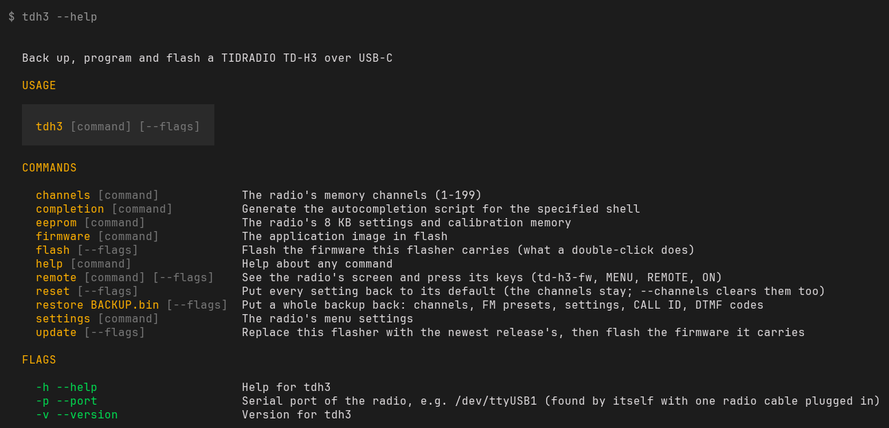
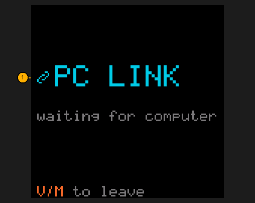
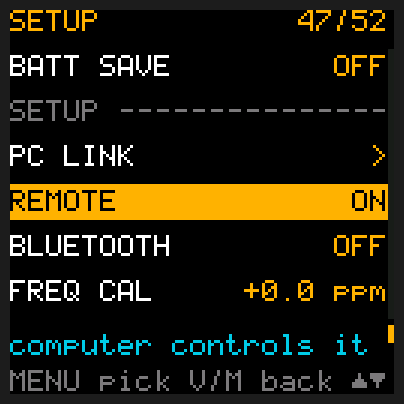
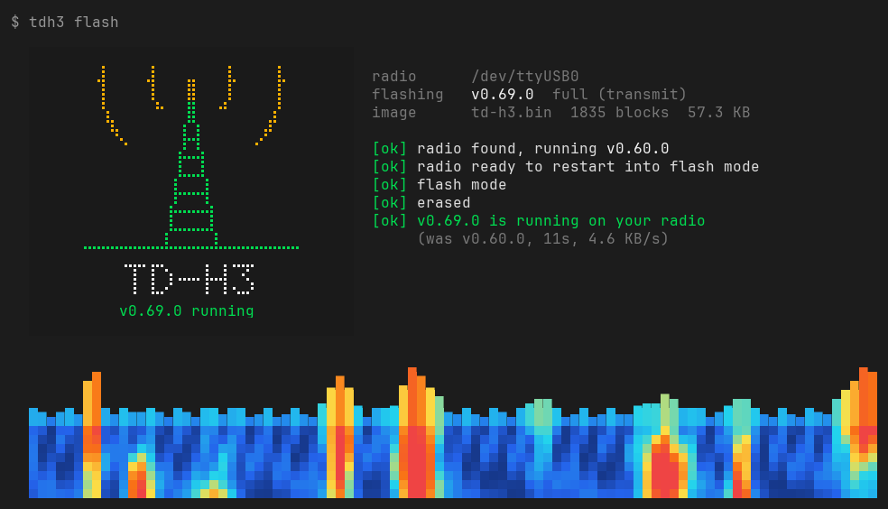
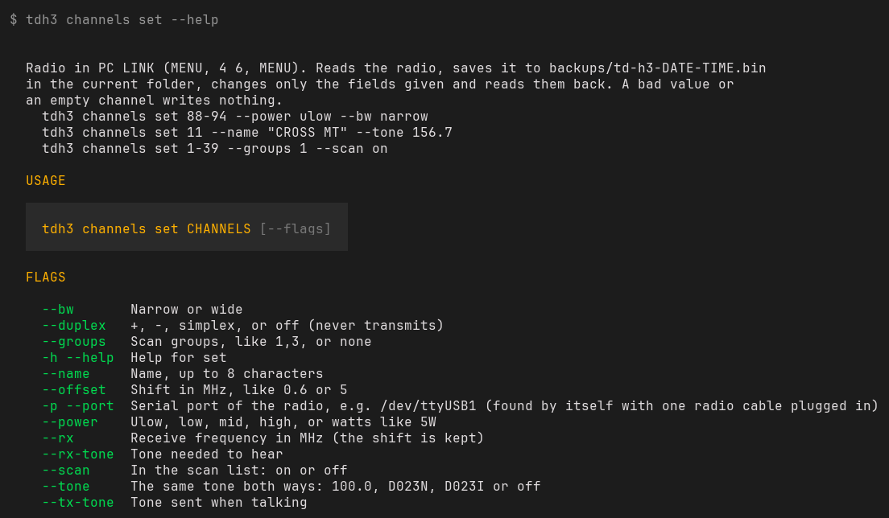
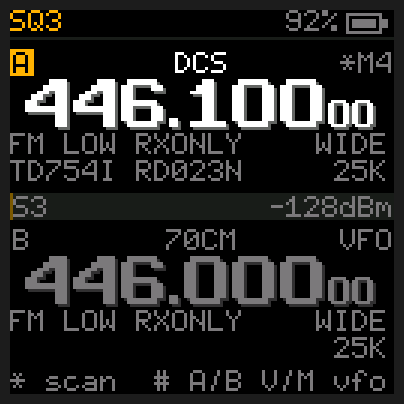

# The tdh3 program

`tdh3` is the flasher you downloaded. Besides putting firmware on the radio, it backs the radio up,
manages its channels and settings, and lets a computer see its screen and press its keys.

## Quick reference

| I want to… | Type | Radio needs |
|---|---|---|
| Put the firmware on the radio | `tdh3 flash` (or double-click the flasher) | Nothing: hold **PTT** when it asks |
| Get the newest version | `tdh3 update` | Internet, then hold **PTT** |
| See my channels | `tdh3 channels list` | PC LINK |
| Change channels | `tdh3 channels set 88-94 --power low` | PC LINK |
| Back up the radio | `tdh3 eeprom backup my-radio.bin` | PC LINK |
| Put a whole backup back | `tdh3 restore my-radio.bin` | PC LINK |
| Put my channels back from a backup | `tdh3 channels copy my-radio.bin` | PC LINK |
| Put my settings back from a backup | `tdh3 settings restore my-radio.bin` | PC LINK |
| See what the radio shows | `tdh3 remote screen` | REMOTE on |
| Let an AI assistant use it | Paste the [prompt below](#using-it-with-an-ai-assistant) | REMOTE on |

## Getting ready

**Running it.** Open a terminal in the folder where the flasher is. The examples here say `tdh3`:
type `.\tdh3.exe` on Windows and `./tdh3` on a Mac or Linux. See [Updating the firmware](Updating).

**Two ways the radio talks to a computer.** Each command needs one of these:

- **PC LINK**: press **MENU**, type **4** **6** (PC LINK), press **MENU**. The screen says
  *waiting for computer*. **V/M** leaves it when you're done. The radio doesn't receive while it's in PC LINK.
- **REMOTE**: press **MENU**, type **4** **7** (REMOTE), press **MENU**, set it to **ON**, press
  **MENU**. It stays on, and the radio works normally. It can never make the radio transmit.

**Several radios plugged in?** Add `-p` and the port, like `-p /dev/ttyUSB1` or `-p COM5`. With one
cable, `tdh3` finds it by itself.

**Commands that change the radio ask first.** `tdh3 restore`, `tdh3 reset`, `tdh3 settings restore`
and `tdh3 channels copy` show what they will do and wait for **Enter**; **Ctrl-C** stops. In a script,
`--yes` (or `-y`) skips the question.

**Every command explains itself.** `tdh3 --help` lists them, and `tdh3 channels set --help` shows
every option of one command. `tdh3 --version` says which version you have.



PC LINK looks like this on the radio, and REMOTE like this once it's on:

 

## Firmware

| Command | What it does | Radio needs |
|---|---|---|
| `tdh3 flash` | Puts on the firmware this flasher carries. `--rx` for the receive-only build; `--yes` waits for the radio without asking (for scripts); `--force` flashes a test build that isn't a release. Typing just `tdh3` does the same. | Hold **PTT** when it asks |
| `tdh3 update` | Downloads the newest flasher, checks its signature, replaces itself, then flashes. `--no-flash` stops before the flash. | Internet |
| `tdh3 firmware flash FILE.bin` | Flashes a firmware file you have. `--force` for a test build. | Hold **PTT** when it asks |
| `tdh3 firmware extract FOLDER` | Saves the firmware this flasher carries as `.bin` files in that folder, the full build and the receive-only one. Leave out the folder to use the current one. | Nothing |



More: [Updating the firmware](Updating).

## Backups

A backup is one file on your computer holding the radio's whole memory: every channel and its
name, the scan list and groups, the FM radio presets, every menu setting, and the radio's factory
calibration. It's always 8,200 bytes. Flashing new firmware doesn't touch this memory, so a backup
isn't needed for an update, but make one before you change a lot at once.

| Command | What it does | Radio needs |
|---|---|---|
| `tdh3 eeprom backup FILE.bin` | Saves a backup to `FILE.bin`. It only reads: nothing on the radio changes. | PC LINK |
| `tdh3 channels list --file FILE.bin` | Shows the channels in a backup. `channels export --file FILE.bin` saves them as a CSV. | Nothing |
| `tdh3 restore FILE.bin` | Puts the whole backup back: channels, FM presets, settings, CALL ID and DTMF codes. Never the calibration. | PC LINK |
| `tdh3 channels copy FILE.bin` | Puts the channels from a backup back (or onto another radio). `--fm=false` keeps this radio's FM presets. | PC LINK |
| `tdh3 settings restore FILE.bin` | Puts the settings from a backup back (or onto another radio). The channels and calibration on the radio stay. | PC LINK |
| `tdh3 reset` | Every setting back to its default. The channels stay; `--channels` empties them too. | PC LINK |

### Making a backup

1. On the radio: press **MENU**, type **4** **6** (PC LINK), press **MENU**. The screen says
   *waiting for computer*.
2. In a terminal in the flasher's folder:
   ```bash
   tdh3 eeprom backup my-radio.bin
   ```
   It says *saved* with the file's name. Press **V/M** on the radio to leave PC LINK.

The file goes in the folder the terminal is in, under the name you typed. Give a new name each
time (`my-radio-june.bin`, say): a file with the same name is replaced without asking. To keep
backups in a folder, make the folder first, then type its name: `tdh3 eeprom backup old/my-radio.bin`.
It also works on a radio with TIDRADIO's own firmware, without PC LINK.

### Backups tdh3 makes by itself

Every command that writes to the radio saves the whole radio first, before it writes anything:
`tdh3 channels import`, `set`, `move`, `clear`, `lock`, `unlock` and `copy`, `tdh3 reset` and
`tdh3 settings restore`.
The file goes in a folder called `backups` inside the folder the terminal is in (it's made if it
isn't there), named with the date and time: `backups/td-h3-20261114-153012.bin` was made on
14 November 2026 at 15:30:12. Two in the same second get `-2`, `-3` after the time, so a backup is
never replaced. The command prints the name. These files are ordinary backups: everything below
works with them.

### Putting a backup back

Radio in PC LINK, then:

```bash
tdh3 restore my-radio.bin
```

It reads the radio and lists what will change: the channels it adds, removes and changes (by
number), the FM radio presets, the settings, the CALL ID and each stored DTMF code, old value then
new. Press **Enter** to go on, or **Ctrl-C** to stop with nothing written. It saves the whole radio
first ([Backups tdh3 makes by itself](#backups-tdh3-makes-by-itself)), puts back everything in the
list, and reads it back to check. If the settings changed, the radio restarts by itself with them.
It works with a backup from another TD-H3 too, and refuses a backup that holds no settings of this
firmware (one made on TIDRADIO's firmware, say).

To put back only a part:

```bash
tdh3 channels copy my-radio.bin
tdh3 settings restore my-radio.bin
```

`channels copy` puts back channels 1-199 (frequencies, tones, power, names, scan list and groups)
and the 25 FM radio presets, and replaces whatever channels the radio has now. It refuses a backup
with no channels in it. `settings restore` puts back every menu setting and what slots A and B were
tuned to; the radio restarts by itself with them. Each shows what it will do and waits for
**Enter**, and reads back what it wrote to check it. Neither puts back the CALL ID or the DTMF
codes: only `tdh3 restore` does.

What a backup never puts back is **the calibration**. Each radio's factory calibration is its own,
so `tdh3` never writes it, not even from that radio's own backup.

More: [Saving and restoring your settings](Updating#saving-and-restoring-your-settings),
[Putting the settings back to defaults](Updating#putting-the-settings-back-to-defaults),
[Copy channels from another radio](Channels-and-Scanning#copy-channels-from-another-radio).

## Channels

| Command | What it does | Radio needs |
|---|---|---|
| `tdh3 channels list` | Shows your channels. `--slots 1-20` for some; `--file FILE.bin` reads a backup instead. | PC LINK, or `--file` |
| `tdh3 channels export FILE.csv` | Saves them as a CHIRP CSV you can edit. `--slots` and `--file` as for `list`. | PC LINK, or `--file` |
| `tdh3 channels import FILE.csv` | Loads a CHIRP CSV. `--dry-run` only shows what it would do; `--clear` empties channels not in the file. | PC LINK |
| `tdh3 channels set CHANNELS` | Changes only what you give: `--name`, `--power`, `--bw`, `--rx`, `--duplex`, `--offset`, `--tone`, `--rx-tone`, `--tx-tone`, `--groups`, `--scan`. | PC LINK |
| `tdh3 channels move FROM TO` | Moves a channel to an empty number. | PC LINK |
| `tdh3 channels clear CHANNELS` | Empties channels. | PC LINK |
| `tdh3 channels lock CHANNELS` | Stops channels ever transmitting. `unlock` makes them simplex again. | PC LINK |
| `tdh3 channels copy FILE.bin` | Copies the whole channel list from a backup, this radio's or another's. `--fm=false` keeps this radio's FM presets. | PC LINK |

`CHANNELS` can be a list and ranges, like `1-39,41,88-94`. Every command here that writes to the
radio saves a backup first ([Backups tdh3 makes by itself](#backups-tdh3-makes-by-itself)). More:
[Changing channels from the computer](Channels-and-Scanning#changing-channels-from-the-computer).




## Remote control

All of these need REMOTE on.

| Command | What it does |
|---|---|
| `tdh3 remote screen` | Prints what the radio shows, as text. `-o shot.png` saves a picture. |
| `tdh3 remote tune 146.520` | Puts the selected slot on a frequency. |
| `tdh3 remote channel 11` | Puts the selected slot on a memory channel. |
| `tdh3 remote slot A` | Selects slot A or B. |
| `tdh3 remote keys 1 4 6` | Presses keys: `0`-`9`, `MENU`, `UP`, `DOWN`, `VM`, `*`, `#`, `TORCH`. Add `:long` to hold one. |
| `tdh3 remote home` | Goes back to the home screen. |
| `tdh3 remote settings` | Lists every menu setting and its value. It only reads. |
| `tdh3 remote watch` | Prints the signal and whether the squelch is open, five times a second, until **Ctrl-C**. `--every 1s` reads less often. |
| `tdh3 remote wait "squelch open"` | Waits until that text shows on the screen. `--gone` waits for it to go; `--timeout 30m` gives up. |
| `tdh3 remote record FILE` | Saves everything the screen shows until **Ctrl-C**. |
| `tdh3 remote replay FILE` | Plays a recording back. `--fast` shows it all at once; `-o my.gif` makes an animated GIF. |

`tdh3 remote screen -o shot.png` saves a picture of the radio's screen, like this one:



If the radio is slow to redraw and a command reads the screen too early, `--wait 3s` gives it
longer (the normal wait is 1.5 seconds).

More: [Recording the screen](Tools#recording-the-screen).

## Using it with an AI assistant

An assistant that can run commands on your computer (Claude Code, Codex and others) can work the
radio with `tdh3`. Switch REMOTE on, then paste this into the chat.

```text
You can operate my TIDRADIO TD-H3 radio, which runs td-h3-fw, with the command-line
program ./tdh3 (called tdh3 below; on Windows it's .\\tdh3.exe). It's connected by USB-C. For exact
options run: tdh3 --help, and tdh3 COMMAND --help.

How the radio connects:
- REMOTE must be on for every `tdh3 remote` command.
- PC LINK is needed for `tdh3 channels`, `eeprom`, `settings`, `restore` and `reset`. To enter it run
  `tdh3 remote keys MENU 4 6 MENU`, wait a few seconds, and try again if the radio doesn't
  answer at first. While it's in PC LINK, `tdh3 remote` won't answer. Ask me to press V/M
  on the radio to leave it.

Working the radio:
- After every step, read the result with `tdh3 remote screen`. Never assume a key worked.
- Use `tdh3 remote wait "TEXT"` to wait for something rather than guessing a delay.
- Go to menu items by number, never by scrolling: `tdh3 remote keys MENU 1 1` opens item 11.
- In a menu item: MENU selects it, UP or DOWN changes the value, MENU confirms. Then press
  V/M ONCE to leave the menu. A second V/M switches the slot between frequency and memory mode.
- `tdh3 remote settings` walks the whole menu and is slow. Use it only when you need every
  setting; to read one value, open that item by number and read the screen.

Safety:
- The radio refuses to transmit from the computer. Don't try to work around that.
- Only with my say-so: `tdh3 flash`, `tdh3 update`, `tdh3 restore`, `tdh3 reset`, `tdh3 settings restore`,
  `tdh3 channels clear`, `import`, `copy` or `lock`, and changing TX BANDS (item 13).
  A flash also needs me to hold PTT.
- Every command that writes to the radio saves a backup of it in backups/ first, and prints its
  name. Tell me that name after any change.
- Leave the radio as you found it: on the home screen, same channel, same settings.
```

To keep it as a Claude Code skill, save it as `~/.claude/skills/td-h3-radio/SKILL.md` with these
lines at the very top:

```text
---
name: td-h3-radio
description: Operate a TD-H3 radio running td-h3-fw with the tdh3 command-line program.
---
```

More on what an assistant can do, and practising without a radio:
[AI agents guide](https://github.com/limehawk/td-h3-fw/blob/main/docs/AI-AGENTS.md).
